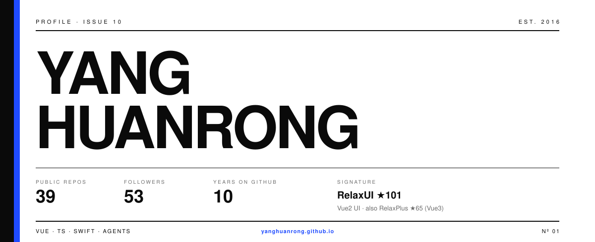

<!--
  GitHub Profile — editorial poster
  Art direction: Swiss / magazine cover (custom SVG, not a template)
-->

  

  <a href="https://yanghuanrong.github.io">Blog</a>
  ·
  <a href="https://github.com/yanghuanrong/RelaxUI">RelaxUI</a>
  ·
  <a href="https://github.com/yanghuanrong/RelaxPlus">RelaxPlus</a>

